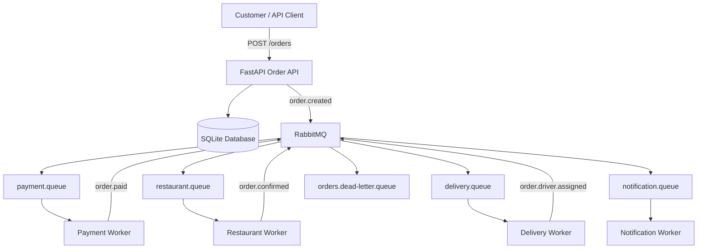

# 02 — Architecture and Event Flow

## High-level flow

## Happy path
1. Client sends `POST /orders`.
2. API validates the body, calculates the total, saves the order as `PENDING`, and publishes `order.created`.
3. Payment worker processes the payment and emits a payment result.
4. Restaurant worker confirms a paid order.
5. Delivery worker assigns a driver.
6. Notification worker logs or stores order updates.
7. Client calls `GET /orders/{order_id}` to inspect the latest state.

## Why asynchronous processing?
- The API can respond without waiting for every worker.
- A slow notification service need not block payment processing.
- Queues can buffer work while workers are busy.
- Worker replicas can be added to process messages concurrently.

## Key terms
- **Producer:** component that publishes a message.
- **Consumer/worker:** component that reads and handles a message.
- **Queue:** buffer holding messages for consumers.
- **Acknowledgement (ack):** tells RabbitMQ that a message was processed.
- **Retry:** attempt to process a transient failure again.
- **Dead-letter queue (DLQ):** destination for messages that cannot be processed after the configured policy.
- **Idempotency:** repeated delivery of the same event should not repeat side effects.
